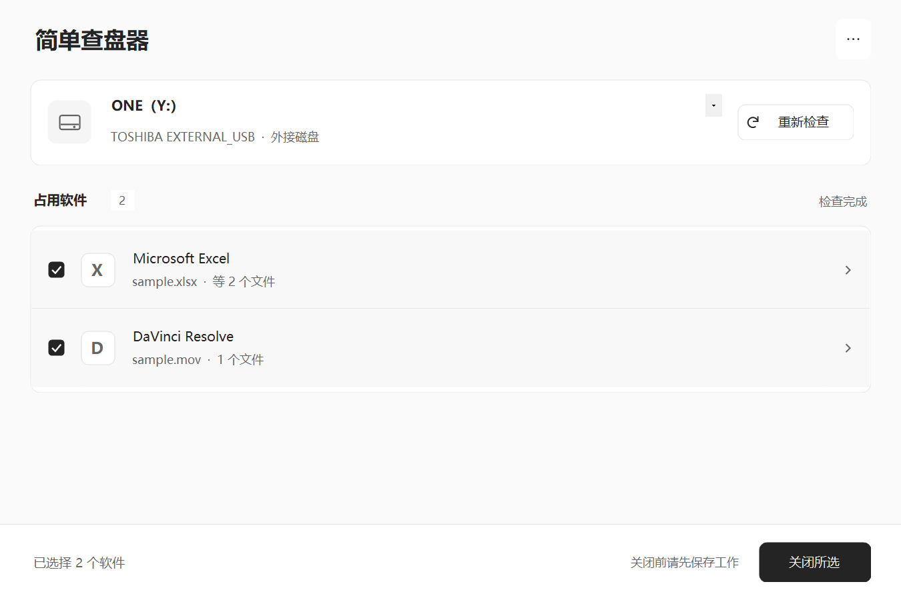
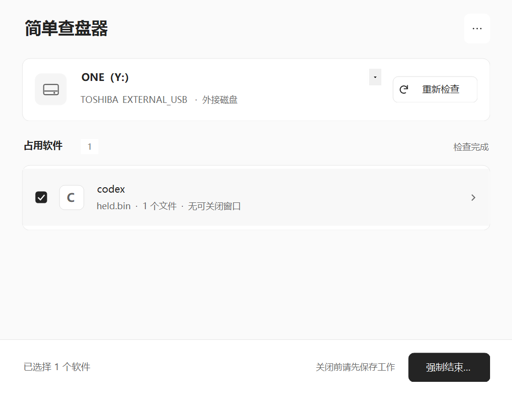

# 简单查盘器

**选磁盘 → 查占用 → 关软件。**

硬盘被软件占用、迟迟不能拔出时，用简单查盘器查看谁正在使用它，再关闭需要处理的软件。一个 Windows 小工具，把常用操作放在一个页面里。

界面采用浅色与黑白灰，保留磁盘选择、软件列表和关闭按钮；完整路径、进程信息与次要操作按需展开。少一点查找，多一点直接。

[下载安装包](https://github.com/yangyiyu789-web/disk-release/releases/latest) · [使用方法](#使用方法) · [源码构建](#从源码构建)



*截图使用演示数据，展示布局与操作方式。*

## 下载与安装

进入 [最新版本 Releases](https://github.com/yangyiyu789-web/disk-release/releases/latest)，展开 **Assets**，下载 `简单查盘器-安装包-1.1.3.exe`，按提示安装到本机磁盘。普通使用只需安装包；`Source code` 和源码 ZIP 面向希望查看或修改代码的人。

- 系统：**64 位 Windows 10 / 11**，**.NET Framework 4.8 或更新版本**；不支持 ARM64。
- 仅为当前用户安装，可选创建桌面快捷方式；安装完成不自动启动。
- 不添加开机启动，不安装驱动或后台服务。请勿安装到准备移除的移动磁盘。
- 程序和安装包尚未数字签名，Windows 可能显示“未知发布者”。请从你信任的来源获取文件。

## 可以做什么

| 功能 | 使用体验 |
| --- | --- |
| 检查磁盘占用 | 选择盘符，集中查看占用的软件与文件 |
| 查看详情 | 需要时展开完整路径和进程信息 |
| 关闭所选软件 | 先请求正常关闭，保留软件自身的保存提示 |
| 单独确认强制结束 | 对无法正常关闭的进程，核对名单后再执行 |
| 更多操作 | 刷新磁盘、管理员检查、关闭相关文件夹，集中收在菜单里 |

工具在本机运行，不联网，不上传路径或进程列表。它负责检查占用和关闭软件，**不执行磁盘弹出**。

## 使用方法

1. 连接磁盘，选择盘符，点击“重新检查”。新接入的磁盘可通过“更多 → 刷新磁盘”更新。
2. 查看列表，点击行末详情查看完整路径和进程信息。
3. **先保存工作**，勾选需要关闭的软件，再点击“关闭所选”。出现保存提示时，请自行处理后重新检查。
4. 若选中的软件全部只能强制结束，主按钮会显示“强制结束…”，点击后须核对名单并确认。混合选择时先尝试正常关闭；也可从“更多 → 强制结束所选…”明确发起强制操作。
5. 处理占用后，使用 **Windows 的安全弹出功能**，确认 Windows 允许移除后再拔线。



*截图为演示数据。主按钮会根据所选软件显示可用操作。*

强制结束可能丢失未保存内容或中断写入。请先保存工作并停止复制；不要用强制结束绕过软件的保存提示。系统关键进程受到保护。

资源管理器不显示在软件列表中，也不会随“关闭所选”自动关闭。需要时可使用“更多 → 关闭相关文件夹”；多标签窗口的其他标签可能一起关闭，工具不会结束整个 `explorer.exe` 进程。

## 检查范围

扫描结果受权限、系统接口和进程状态影响，**空列表不保证磁盘没有占用**。系统服务、驱动、杀毒扫描或正在进行的写入仍可能阻止安全弹出。普通权限下结果不全时，可尝试“更多 → 管理员运行”。内部磁盘可通过“更多 → 显示内部盘（仅检查）”查看。

本工具不执行磁盘弹出或强行卸载。关闭软件后仍须由 Windows 完成最终安全弹出；弹出失败时，请等待后台任务结束或手动处理。

## 从源码构建

在 Windows x64 上使用 PowerShell。应用使用系统自带的 .NET Framework C# 编译器，不需要 Visual Studio；构建前需安装 .NET Framework 4.8 或更新版本。

```powershell
powershell -NoProfile -ExecutionPolicy Bypass -File .\build.ps1
```

程序输出到 `bin\DiskRelease.exe`。制作安装包还需从 [Inno Setup 官网](https://jrsoftware.org/isdl.php)获取编译器，本项目使用 6.7.3。编译器不随源码分发；将下例路径替换为本机的 `ISCC.exe` 路径：

```powershell
powershell -NoProfile -ExecutionPolicy Bypass -File .\build.ps1 -Installer -InnoSetupCompiler "C:\Program Files (x86)\Inno Setup 6\ISCC.exe"
```

安装包输出到 `dist\简单查盘器-安装包-1.1.3.exe`。构建过程不自动下载依赖或启动应用。

## 测试

```powershell
powershell -NoProfile -ExecutionPolicy Bypass -File .\tests\run-tests.ps1
```

默认运行三组测试，检查界面布局与操作限制、资源管理器列表投影、主按钮的正常关闭与强制结束状态。它们使用测试数据，不结束真实用户软件。

可额外运行扫描辅助进程的无效磁盘身份协议检查：

```powershell
powershell -NoProfile -ExecutionPolicy Bypass -File .\tests\run-tests.ps1 -IncludeWorkerProtocol
```

这些检查不能代替在真实磁盘上验证扫描结果或 Windows 安全弹出。

## 目录

```text
src/                    应用源码、图标与清单
tests/                  测试源码与脚本
docs/images/            使用示例截图（演示数据）
installer-assets/       安装器简体中文语言文件及来源说明
licenses/               第三方许可文本
build.ps1               构建应用与安装包
installer.iss           Inno Setup 安装脚本
中文使用说明.txt          随程序提供的使用说明
安装说明.txt              安装前提示
```

编译产物与本机编译器不纳入源码仓库。版本变化见 [CHANGELOG.md](CHANGELOG.md)。

## 许可

本项目原创代码采用 [MIT License](LICENSE)。安装器语言文件及 Inno Setup 生成的安装引擎保留其各自的许可与声明，详见 [第三方声明](THIRD-PARTY-NOTICES.md)；本项目的 MIT 许可不覆盖第三方材料。
